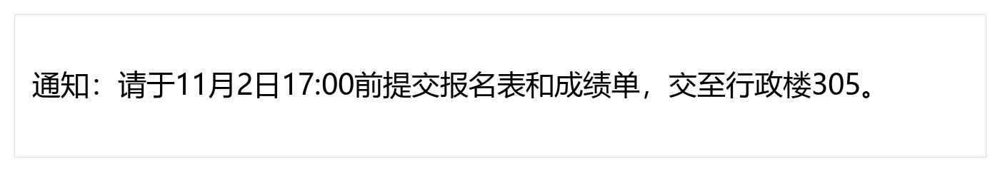
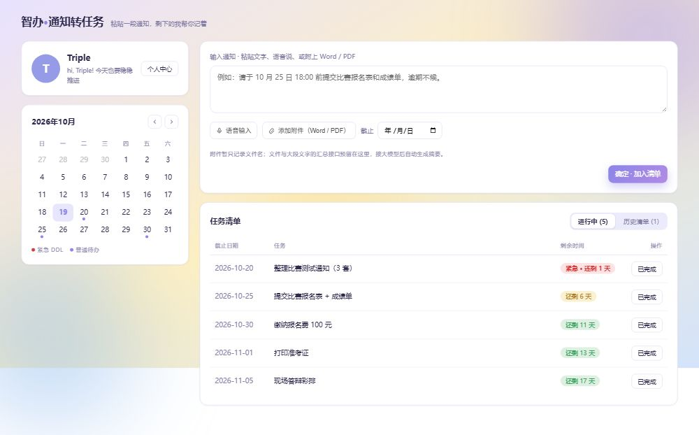

# 不漏办 · 智能办事清单助手

> 参赛作品介绍文档
> 队伍：Triple Y（A 李丹阳 / B 敬柯盈 / C 方可圆）
> 项目仓库：<https://github.com/sssweetis/chuanzhi-cup-ai-web_Triple-Y>
> 文档版本：2026-10-30

## 1. 项目详情及使用方式

### 1.1 项目是什么

「不漏办」是一款面向校园与职场办事场景的 AI Web 应用。用户粘贴一段通知文字、上传通知截图，或上传文字型 PDF，系统会把非结构化通知转换成一份结构化办事清单：

- 截止时间与提醒；
- 材料清单（必交 / 选填 / 条件材料）；
- 办理步骤与先后依赖；
- 可勾选的待办事项；
- 每条要求的原文出处；
- 补充通知的变化对比与用户确认；
- 清单版本历史、CSV / Markdown 导出。

一句话：**把“读完就忘”的通知，变成“可以照着做”的清单。**

### 1.2 目标用户

- 在校学生：奖助学金、竞赛报名、证件办理、评优申报；
- 社团 / 学院内勤：活动立项、场地申请、经费报销；
- 职场人士：入职材料、资质办理、行政审批。

### 1.3 使用方式

1. 打开网页，在输入区粘贴通知文字，或上传截图 / 文字型 PDF；
2. 点击「AI 智能解析」，系统判断通知复杂度，输出极简 / 标准 / 完整流程三档结构；
3. 在「我们队的情况」勾选已准备材料、填写人数/视频等情况，点击「提交核对」；
4. 系统分三类告诉用户：已准备、缺少、需要确认；
5. 点击材料 / 步骤 / 待办后的「出处」，可以查看对应原文片段；
6. 把结果加入任务清单，可勾选、修改、保存、下载 CSV / Markdown；
7. 如果收到补充通知，使用「补充通知对比」，先预览差异，确认后再更新清单；
8. 日期工具会提示剩余天数、星期、周末/节假日和风险建议；
9. 材料库支持上传多份材料，并基于材料内容追问，回答附文件名与片段编号。

*图 1：演示数据包中的通知截图，可直接上传走截图识别流程。*

*图 2：项目早期界面原型（用于说明布局；最终界面以当前前端代码为准）。*

## 2. 项目亮点

1. **三档结构自适应**
   不是所有通知都给一堆字段。系统按复杂度输出 simple / standard / complex，简单通知只保留必要信息，复杂通知才展开审核、依赖、预警。

2. **每条要求可追溯**
   材料、步骤、待办、截止时间都可以带 `source_ref.quote`；没有原文依据的内容标为“系统建议”，不把 AI 补充伪装成原文。

3. **从“读通知”到“能执行”**
   输出不是一段总结，而是可勾选材料、可排序步骤、可保存待办、可导出清单。

4. **补充通知有“预览—确认—留档”**
   改期、新增材料、删除材料先对比；没写“以此为准”时要求用户确认；确认后才更新并保留旧版本内容。

5. **多模态与降级**
   文字、截图、文字型 PDF 共用一套抽取管道；视觉模型不可用降级本地 OCR，无 Key 走离线 Mock，页面不白屏。

6. **真实模型已落地**
   团队 Key 使用 DeepSeek Flash，真实文本 / 截图 / PDF / RAG / Function Calling 已完成首轮验收。

## 3. AI 技术落地与测试情况概述

### 3.1 真实模型接入

- 文本与视觉模型：DeepSeek `deepseek-flash`；
- 接口：OpenAI 兼容的 Chat Completions 调用格式；
- 真实模式 `/health` 返回 `mode=real`。

### 3.2 已完成的真实测试

| 测试 | 结果 |
| --- | --- |
| `preflight.py` 演示前自检 | 13/13 |
| `smoke_test_hardening.py` 加固测试 | 19/19 |
| `smoke_test_acceptance.py` 三档验收 | simple / standard / complex 3/3 |
| A 侧确定性测试 | 95/95 |
| 真实文本样本 | 3 条通过，单条约 20–42s |
| 真实截图 | 通过，约 9.6s，日期归一化为 ISO |
| 真实 PDF | 通过，约 21.6s |
| RAG 追问 | 材料内回答附出处；材料外明确拒答 |
| 日期工具 | 真实 Function Calling，`tool_trace` 可见 |

### 3.3 测试方法与数据

- 演示数据：`docs/demo-kit/`，包含普通通知、完整流程、截图、文字型 PDF、补充通知对、标准答案；
- 测试文档：`docs/AI侧测试用例与答案.md`、`docs/第三阶段测试用例.md`；
- 内测计划：在完成公网/内网穿透部署后，邀请同学按“上传→解析→核对→保存→追问→对比”完整流程试用，记录卡点并修复；内测结果将在提交前补入本文件。

## 4. 关键技术

| 技术点 | 实现 |
| --- | --- |
| 结构化抽取 | Prompt + JSON Schema + 代码字段裁剪；三档模式；空字段修补 |
| 防幻觉 | `source_ref.quote`、`is_suggestion`、无依据拒答、外部材料库约束 |
| RAG | 文本切片、片段编号、中文二元组 / LCS 检索、Top-K 上下文、附出处回答 |
| 多模态 | 截图视觉模型、RapidOCR 兜底、文字型 PDF pypdf/pymupdf |
| Agent / 工具调用 | `check_date` Function Calling、工具轨迹、失败兜底 |
| 通知变化 | 两份 Matter 差异、增量合并、受影响待办、用户确认、`change_log` |
| 工程化 | FastAPI、Vite、本地 JSON 原子写、Docker、Render/VPS 部署配置、会话隔离、限流 |
| 可测试性 | 9 套后端自测、A 侧 95 项确定性检查、preflight 一键自检 |

## 5. 项目相关图片

- 图 1：通知截图示例（`docs/demo-kit/04-通知截图.png`）；
- 图 2：早期界面原型（`homepage-prototype/_shots/主页_desktop.jpg`）；
- 更多界面截图与操作流程图将在内测完成后补充到技术文档与提交包中。

## 6. 是否发表过或获奖

本项目**未发表过，也未获奖过**。

## 7. 是否在其他项目基础上优化

本项目为本次比赛独立开发。Git 历史从团队自研的文字通知解析原型开始，后续在本项目内迭代出三档结构、RAG、多模态、补充通知对比、日期工具、会话隔离等能力；**未基于其他现成开源项目做二次开发**。

## 8. 当前边界与后续规划

当前版本优先保证“可演示、可核验、可执行”，仍有清晰边界：

- **文档类型**：重点支持清晰截图和文字型 PDF；扫描版 PDF、复杂表格、手写体、印章遮挡仍需人工核对或改用截图；
- **检索方式**：当前是轻量词法检索，不是向量检索；同义改写、跨段落归纳的召回还有提升空间，后续计划加入向量检索与重排；
- **条件与复杂分支**：已支持“大一/大二”这类条件材料和年级过滤；多层嵌套条件（如“应届生且已入党……”）仍在后续规划；
- **通知变化**：已支持补充通知增量合并、用户确认和版本留档；连续多份补充通知、跨段落语义改期仍需要更多测试；
- **日期与校历**：已支持周末和常见固定节假日提示；农历节日、地方假期、调休需要以学校/单位通知为准；
- **会话与权限**：`X-Session-Id` 提供浏览器会话隔离，但不是登录鉴权；账号体系、多人协作、权限管理属于后续规划；
- **提醒**：已生成 DDL 提醒任务，浏览器/系统推送尚未接入；
- **部署与演示**：Docker / Render / VPS 配置已准备，公网地址与演示视频将在提交前补齐。

后续迭代方向：向量检索与重排、复杂条件分支、多文件合并、日历/飞书同步、多人协作、移动端体验优化。
